 &nbsp; 

## Latest from Field Notes

<!-- BLOG-POSTS:START -->
- [The Trouble with Universal IDs: Part 2](https://blog.mumojack.dev/the-trouble-with-universal-ids-part-2)
- [Circuit Breakers and Cascading Failures](https://blog.mumojack.dev/circuit-breakers-and-cascading-failures)
- [The Trouble with Universal IDs: Part 1](https://blog.mumojack.dev/the-trouble-with-universal-ids-part-1)
<!-- BLOG-POSTS:END -->

## My tools

